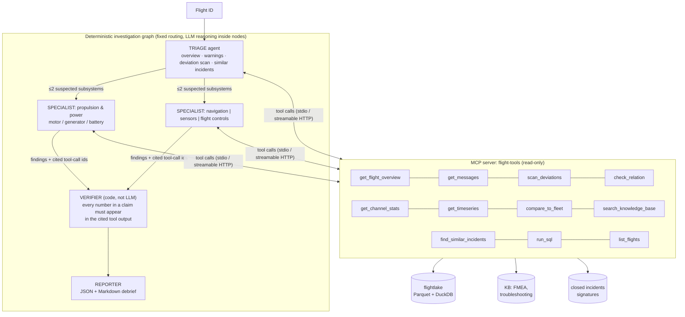

# flight-investigator-agent 🕵️‍♂️✈️

**A multi-agent root-cause investigator for flight-test logs.** You hand it a flight ID. Within seconds you get back a debrief: root cause, onset time, flight phase, verified evidence, similar past incidents, and recommended actions. Every number in the report can be traced to a specific tool call.

The agents never see raw data dumps. They work through **11 read-only diagnostic tools served over MCP** (Model Context Protocol). These include physics-consistency checks, fleet-envelope deviation scans, a BM25 knowledge base over FMEA and troubleshooting guides, and similar-incident retrieval. A **deterministic verifier** rejects any claim whose numbers don't appear in the tool output it cites.

> Built on [flightlake](https://github.com//flightlake). The tools can be plugged into Claude Desktop or Claude Code, the Anthropic API, any OpenAI-compatible endpoint (vLLM, Ollama, Gemini), or the offline `scripted` policy, which runs in CI with no API key.



## Design choices

| Choice | Why |
|---|---|
| **Fixed graph, LLM inside nodes.** Triage → ≤2 specialists → verifier → reporter. | Behaviour is reproducible and auditable, and cost is bounded. A free-roaming agent loop is hard to certify for flight-test use. |
| **Scoped tools per agent** and a hard step budget (8 calls per agent). | Specialists cannot wander. Cost and latency stay predictable. |
| **Physics-consistency tools** (`airspeed_vs_groundspeed`, `elevator_cmd_vs_pos`, `throttle_vs_rpm`, `power_balance`, `gnss_health_vs_innovation`). | These encode the checks a flight-test engineer runs by hand. The LLM reasons over verdicts and breach times rather than reading thousands of samples. |
| **Code-based verifier**, not LLM-as-judge, for grounding. | It is cheap and deterministic, and it removes hallucinated numbers from the report outright. Rejected claims are shown struck through. |
| **Ground truth hidden** from tools (no `labels`, no injected-fault columns, and the SQL guard enforces it). | An honest evaluation: the agent cannot read the answer key. |
| **Golden / history split.** Incidents and the fleet envelope are built only from history flights. | Similar-incident retrieval cannot leak the golden answers. |
| **Provider-agnostic transcript.** Anthropic, OpenAI-compatible and scripted backends. | Models can be swapped or A/B tested, and CI runs offline. |

## Results: golden incident set (82 flights, 9 classes including nominal)

`investigator evaluate --provider <p>`. All numbers come from the reproducible simulated fleet (`make data incidents`).

| Agent policy | Root-cause acc. | Subsystem acc. | Onset MAE | Onset within 30 s | Evidence grounded | Tool calls / flight | Latency |
|---|---|---|---|---|---|---|---|
| `scripted` expert rules (offline baseline) | **0.89** | 0.89 | 29.3 s | 0.87 | 1.00 | 8.7 | 0.24 s |
| `anthropic` (Claude) | *run `make eval-claude`* | | | | | | |
| `openai` (e.g. local Qwen via vLLM) | *run with `OPENAI_BASE_URL`* | | | | | | |

The expert-rules baseline catches 100 % of motor, generator, GNSS, pitot, vibration and elevator faults. It finds only **20 % of battery degradations**: a weak cell group hides behind the generator in cruise, and a percentile threshold on minimum voltage is too blunt. This is exactly where an LLM specialist that reasons over `get_timeseries(batt_v, batt_a)` and the knowledge base ("voltage below fleet norm for the same SOC and current") should beat the rules. The eval harness reports per-class recall and the top confusions, so that comparison is a single command.

Example report (offline policy, real output):

```text
# Flight investigation - FLT-00010
Root cause: gnss_jamming (navigation) - confidence 0.9
Onset: 231.4 s (cruise)
## Evidence
- satellites dropped to 0.0 with hdop 99.0 from t=231.4 s; EKF accuracy grew to 93.16 m  (tool call call_0005)
## Similar past incidents
- FLT-00131 (sim 0.998): gnss_jamming - range interference confirmed; test card moved
## Recommended actions
- Check NOTAMs and local interference reports for the test range.
- Quantify dead-reckoning drift during the outage and time to reacquire.
```

## Quickstart

```bash
pip install -e ".[dev,anthropic]"            # also installs flightlake
make data incidents                           # 300 simulated sorties -> lake; build incident DB (history split)
make test                                     # verifier, tool sandboxing, KB search, e2e graph, real MCP stdio round-trip
investigator investigate FLT-00010            # offline scripted policy
investigator investigate FLT-00010 --mcp      # same, but every tool call goes through the MCP server (stdio)

export ANTHROPIC_API_KEY=...                  # optional: ANTHROPIC_MODEL=<model id>
investigator investigate FLT-00042 --provider anthropic
investigator evaluate --provider anthropic --limit 40

# any OpenAI-compatible server, e.g. a local model:
vllm serve Qwen/Qwen2.5-7B-Instruct --enable-auto-tool-choice --tool-call-parser hermes
OPENAI_BASE_URL=http://localhost:8000/v1 OPENAI_MODEL=Qwen/Qwen2.5-7B-Instruct investigator evaluate --provider openai
```

### Use the tools from Claude Desktop / Claude Code
```json
{"mcpServers": {"flight-tools": {
  "command": "python", "args": ["-m", "flightinvestigator.mcp_server"],
  "env": {"FLIGHTLAKE_ROOT": "/abs/path/data/lake", "INCIDENTS_PATH": "/abs/path/data/incidents.json"}}}}
```
Then ask, for example: *"Why did FLT-00042 lose altitude in cruise? Check airspeed consistency first."*

## Deployment

```bash
docker compose up --build     # :8765 MCP server (streamable HTTP), :8090 REST API (/investigate/{id}?format=md)
```
**Cloud Run:** build the image, mount the lake bucket read-only (Cloud Storage FUSE), keep the service private (`--no-allow-unauthenticated`), and store `ANTHROPIC_API_KEY` in Secret Manager. The MCP server deploys as its own service, so other agents and IDEs can share the same tool layer.

**Observability:** every report includes a trace (tool calls with args and latency, LLM calls, tokens). Forward `reports_*.jsonl` to Langfuse or BigQuery to track accuracy, cost per investigation and tool-error rates over time.

## Repository layout
```
src/flightinvestigator/
  tools.py          # 11 read-only diagnostic tools + fleet envelope + BM25 KB + incident signatures
  specs.py          # JSON-schema tool specs shown to LLMs
  mcp_server.py     # MCP server (SDK 1.x and 2.x), stdio + streamable HTTP, readOnly tool annotations
  toolbox.py        # in-process or MCP-client tool execution
  agents/graph.py   # triage -> specialists -> verifier -> reporter
  agents/llm.py     # Anthropic + OpenAI-compatible tool-calling clients
  agents/scripted.py# deterministic offline policy / expert-rules baseline
  incidents.py      # closed-incident DB from the history split
  evaluate.py       # golden-set metrics
kb/                 # FMEA + troubleshooting + procedures (RAG corpus)
```

MIT licensed.
